<picture>
  <source media="(prefers-color-scheme: dark)" srcset="assets/hero-dark.svg">
  <source media="(prefers-color-scheme: light)" srcset="assets/hero-light.svg">
  
</picture>

<p align="center">
  <a href="https://abmtech.in"><b>abmtech.in</b></a> &nbsp;·&nbsp;
  <a href="https://nestiq.si"><b>nestiq.si</b></a> &nbsp;·&nbsp;
  <a href="https://www.linkedin.com/in/boora-aman/">LinkedIn</a> &nbsp;·&nbsp;
  <a href="mailto:aman.chaudharyboora@gmail.com">Email</a>
</p>

<br>

I design and ship business software from the database to the phone in a sales rep's pocket: **Frappe/ERPNext** apps, **Next.js** and **Vue** frontends, **React Native** mobile apps, **Rust** and **Go** services, and **LLM agents** that know where their limits are.

I founded **[ABM Tech](https://abmtech.in)**, where we build CRM, ERP and automation for Indian businesses. At **Alfastack** I'm a core engineer on **NestIQ** and on Frappe systems for government clients. I trained in cybersecurity (CEH), so access control, audit trails and zero-trust setups come with every build.

<br>

## `$ ls ~/systems --live`

| | System | What it does | Built with |
|:-:|---|---|---|
| ◆ | **[NestIQ](https://nestiq.si)** | True-shape nesting SaaS for laser and sheet-metal shops. Upload DXF/SVG, nest parts on plates, export cutting programs. An AI agent reviews each nest and keeps only verified improvements. | Next.js · FastAPI · Rust · Frappe billing |
| ◆ | **ABM CRM** | Sales CRM for teams that run on ads. Routes leads by Meta campaign, ad set and ad, sends email from each rep's own address, and tracks site visits and idle leads. | Frappe CRM v16 · Vue · Meta Graph API |
| ◆ | **ABM CRM · Android** | The CRM in a rep's pocket: automatic call logging and recordings, GPS site-visit check-ins, team dashboards, works offline. | React Native · Expo |
| ◆ | **BenchPilot** | Self-hosted alternative to Frappe Cloud. Benches, sites, deploys with auto-rollback, and backups, on servers you own. | Frappe · Go agent · Vue 3 · Traefik |
| ◆ | **[PetroDiesel](https://github.com/boora-aman/petrodiesel)** | ERP for fuel stations: nozzle readings, shift cash closing, tanker decantation, Daily Stock Register. Every entry posts to the ledger. Live at 3 outlets. | ERPNext v16 |
| ◆ | **Gift Management** | Government diplomatic gift operations: 7 modules, warehouse tracking, English/Arabic RTL, full audit trail. | Frappe · React |
| ◆ | **Digital Concierge** | Platform for VVIP visits: segment-based itineraries, real-time chat, VPN/IP-whitelisted zero-trust access. | Frappe · WebSockets |
| ◆ | **3CX ↔ ERPNext** | Caller screen-pop, automatic call logs, click-to-call, two-way contact sync with a 3CX phone system. | Frappe · 3CX XAPI |
| ◇ | **[Claudia](https://github.com/boora-aman/claudia)** | Open-source Linux desktop client for Claude Code. Ships as `.deb` and AppImage. | JavaScript · Electron |
| ◇ | **LocalRing** | *Building:* routes calls from 4–6 phones to one hub device over WiFi. | Node.js · Kotlin · WebSockets |

<sub>◆ in production &nbsp;·&nbsp; ◇ open source / in progress &nbsp;·&nbsp; most client and product repos are private; demos on request</sub>

<br>

## `$ cat stack.yaml`

<picture>
  <source media="(prefers-color-scheme: dark)" srcset="assets/stack-dark.svg">
  <source media="(prefers-color-scheme: light)" srcset="assets/stack-light.svg">
  
</picture>

<br>

## `$ git log --oneline ~/life`

```diff
+ 2026  shipped   AI Nest Agent: vision LLM proposes, Rust engine verifies
+ 2026  launched  ABM CRM + Android app for sales teams that run on Meta ads
+ 2026  built     BenchPilot: Frappe Cloud-style control panel for self-hosted servers
+ 2026  released  PetroDiesel on ERPNext v16, live at 3 fuel outlets
+ 2026  graduated B.Tech CSE (Cybersecurity), Bennett University, CGPA 8.9
+ 2025  joined    Alfastack: government-grade Frappe systems, then NestIQ
+ 2023  started   full-stack at Tech Fusion: Flask + React for 25k+ monthly users
! ----  won       1st place, Bid n Build Hackathon (Android carpooling app)
```

<br>

## `$ man aman`

<table>
<tr>
<td width="50%" valign="top">

**The model proposes, the system verifies.**<br>
<sub>An LLM never writes straight to production state. It suggests; deterministic code checks the suggestion and keeps only real improvements.</sub>

**Every action leaves a trail.**<br>
<sub>Who did what, when, and to which record. Government clients taught me this, and now every system I build has it.</sub>

</td>
<td width="50%" valign="top">

**Your servers, your data.**<br>
<sub>Self-hosting comes first. No per-seat fees and no lock-in, with an open-source core where possible.</sub>

**Boring stack, sharp product.**<br>
<sub>Proven tools for the plumbing. The effort goes into the workflow the user actually touches.</sub>

</td>
</tr>
</table>

<br>

<p align="center">
  <sub>Open to work on <b>Frappe/ERPNext</b>, <b>product engineering</b> and <b>AI automation</b>, and to collaborations on all three.<br>
  <code>$ echo "hi" | mail aman.chaudharyboora@gmail.com</code></sub>
</p>
