<!-- ═══════════════════════════ HEADER ═══════════════════════════ -->


<div align="center">

<a href="https://github.com/boora-aman">
  
</a>

<p>
  <a href="https://www.linkedin.com/in/boora-aman/"></a>
  <a href="mailto:aman.chaudharyboora@gmail.com"></a>
  <a href="https://abmtech.in"></a>
  <a href="https://nestiq.si"></a>
  
</p>

</div>

---

## 🧑‍💻 About Me

```yaml
name:      Aman Boora
role:      Full-Stack Product Engineer · Frappe/ERPNext Architect
founder:   ABM Tech            # CRM, ERP & AI automation for Indian businesses
engineer:  Alfastack Solution  # NestIQ SaaS + government-grade Frappe systems
location:  Dehradun, India 🇮🇳
education: B.Tech CSE (Cybersecurity) · Bennett University · CGPA 8.9
certs:     [Certified Ethical Hacker (CEH)]
shipping:  [NestIQ, ABM CRM, ABM CRM Android, BenchPilot, PetroDiesel]
building:  LocalRing  # WiFi call routing across phones to one hub
motto:     "LLM proposes, engine verifies, audit trail remembers."
```

- 🚀 **3+ years, 10+ systems in production** across government, real estate, fuel retail, logistics and manufacturing
- 🏛️ **Government-grade builds**: diplomatic gift operations, VVIP protocol, zero-trust access, full audit trails
- 🤖 **AI that earns its place**: a vision-LLM agent steering a Rust nesting engine, keeping only verified gains
- 📱 **Database to pocket**: Frappe backends, Next.js/Vue dashboards, React Native apps for field sales teams
- 🛡️ **Security by default** (CEH): roles, permission rules, VPN/IP whitelisting on every build

---

## 🔥 Flagship Products

<table>
<tr>
<td width="50%" valign="top">

### ⚙️ [NestIQ](https://nestiq.si)
**AI-powered true-shape nesting SaaS** for laser & sheet-metal shops. Drop DXF/SVG parts, nest them on plates, export cutting programs. The **AI Nest Agent** reviews every layout and keeps only measurable improvements.


</td>
<td width="50%" valign="top">

### 📈 ABM CRM
**Sales CRM for teams that run on Meta ads.** Leads routed by campaign, ad set & ad, round-robin with caps, per-rep sender email, WhatsApp templates, site-visit dashboards, idle-lead alerts.


</td>
</tr>
<tr>
<td width="50%" valign="top">

### 📱 ABM CRM · Android
**The CRM in a rep's pocket.** Automatic call logging & recordings, GPS site-visit check-ins with photos, live team dashboard for managers, works fully offline.


</td>
<td width="50%" valign="top">

### 🛰️ BenchPilot
**Your own Frappe Cloud.** Benches, sites, deploys with auto-rollback and S3 backups, on servers you own. Outbound-only Go agent, works behind NAT.


</td>
</tr>
<tr>
<td width="50%" valign="top">

### ⛽ [PetroDiesel](https://github.com/boora-aman/petrodiesel)
**Open-source ERP for fuel stations.** Nozzle readings, shift cash closing, tanker decantation, Daily Stock Register, all posting to the ledger. **Live at 3 outlets.**


</td>
<td width="50%" valign="top">

### 🖥️ [Claudia](https://github.com/boora-aman/claudia)
**Open-source Linux desktop client for Claude Code.** Ships as `.deb` and AppImage.


</td>
</tr>
</table>

### 🏛️ Enterprise & Government Builds

| | Project | Highlights |
|:-:|---|---|
| 🎁 | **Gift Management System** | Government diplomatic ops · 7 modules · warehouse tracking · EN/AR RTL · full audit trail |
| 🛎️ | **Digital Concierge** | VVIP visits (PMs, Presidents) · segment itineraries · WebSocket chat · zero-trust VPN/IP access |
| 📞 | **3CX ↔ ERPNext** | Caller screen-pop · automatic call logs · click-to-call · two-way contact sync |
| 👥 | **Alfa HR** | Recruitment for 100–150 candidates per cycle · −70% manual coordination |
| 📡 | **LocalRing** *(building)* | WiFi call routing from 4–6 phones to one hub · Node.js · Kotlin · WebSockets |

---

## 🛠️ Tech Arsenal

<div align="center">

**🏛️ ERP & Core**<br/>


<br/>

**💻 Languages**<br/>


**🎨 Frontend & Mobile**<br/>


**⚙️ Backend & Data**<br/>


**☁️ DevOps & Tools**<br/>


**🤖 AI & Integrations**<br/>


</div>

---

## 📊 GitHub Analytics

<div align="center">




<picture>
  <source media="(prefers-color-scheme: dark)" srcset="https://raw.githubusercontent.com/boora-aman/boora-aman/output/snake-dark.svg?v=1">
  
</picture>

</div>

---

## 🧭 Journey

```diff
+ 2026 🚀 Shipped AI Nest Agent: vision LLM proposes, Rust engine verifies
+ 2026 📈 Launched ABM CRM + Android app for Meta-ads sales teams
+ 2026 🛰️ Built BenchPilot: self-hosted Frappe Cloud
+ 2026 ⛽ Released PetroDiesel on ERPNext v16, live at 3 outlets
+ 2026 🎓 Graduated B.Tech CSE (Cybersecurity), CGPA 8.9
+ 2025 🏛️ Joined Alfastack: government-grade Frappe systems, then NestIQ
+ 2023 💻 Started full-stack at Tech Fusion: Flask + React, 25k+ monthly users
! ---- 🏆 1st place, Bid n Build Hackathon (Android carpooling app)
```

---

<div align="center">

### 🤝 Let's build something

**Frappe/ERPNext** · **SaaS products** · **AI automation**: open to work and collaboration.

> 💡 *"LLM proposes, engine verifies, audit trail remembers."*

</div>


